<div align="center">


# Hishab

**Personal finance, wallets, budgets, and instant mobile bookkeeping — in English, বাংলা, and Banglish.**

[](https://github.com/shahriarjahin/my-daily-hishab/releases/latest)
[](docs/FINANCE_FEATURES.md)

[](https://github.com/shahriarjahin/my-daily-hishab/releases/latest)
[](https://github.com/shahriarjahin/my-daily-hishab/releases)
[](https://github.com/shahriarjahin/my-daily-hishab/stargazers)
[](https://github.com/shahriarjahin/my-daily-hishab/issues)
[](https://github.com/shahriarjahin/my-daily-hishab/commits/main)

React 19 · TypeScript · Capacitor 8 · FastAPI · PostgreSQL / SQLModel · Supabase

</div>

---

## Overview

Hishab is a cloud-synced and offline-capable personal finance platform tailored for everyday cash, mobile financial services (bKash, Nagad, Rocket), and bank accounts. It pairs a React web app hosted on FastAPI/Vercel with a native Android build backed by Android Keystore-encrypted SQLite, on-device AI inference, home screen widgets, quick tiles, and share-sheet SMS parsing.

## Screenshots

Screenshots captured on device using the demo workspace. Select any screen for full resolution.

<table>
  <tr>
    <td align="center"><strong>Home &amp; cash flow</strong><br /><br /><a href="screenshots/home.PNG">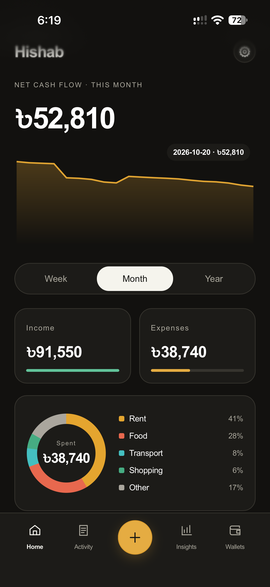</a></td>
    <td align="center"><strong>Activity &amp; filters</strong><br /><br /><a href="screenshots/activity.PNG">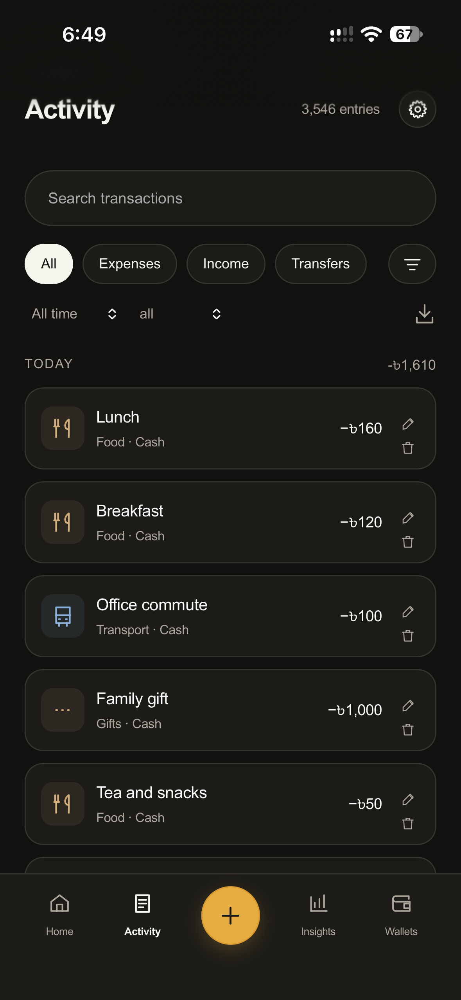</a></td>
    <td align="center"><strong>Spending insights</strong><br /><br /><a href="screenshots/insights.PNG">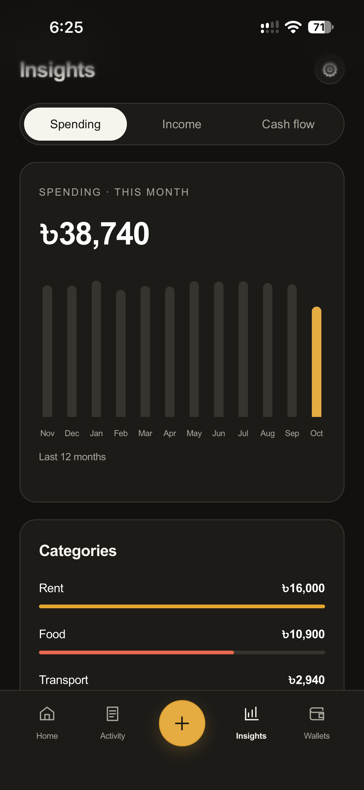</a></td>
  </tr>
</table>

<table>
  <tr>
    <td align="center"><strong>Light theme</strong><br /><br /><a href="screenshots/light_theme.PNG">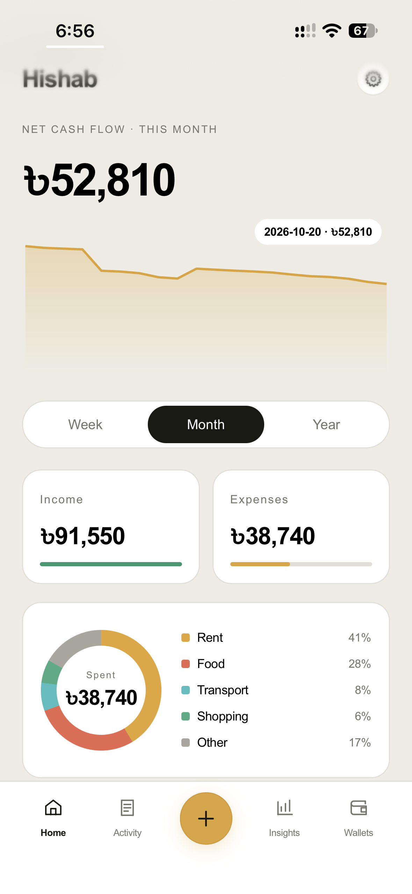</a></td>
    <td align="center"><strong>Glass theme · বাংলা</strong><br /><br /><a href="screenshots/glass_theme_BNG.PNG">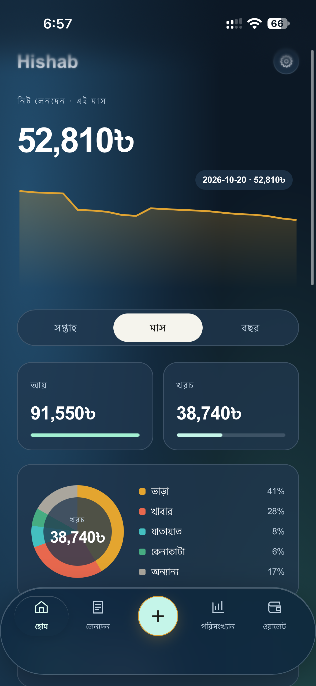</a></td>
  </tr>
</table>

<details>
<summary><strong>More screens (wallets, budgets, goals, entry, transfers, loans, settings &amp; auth)</strong></summary>

<table>
  <tr>
    <td align="center"><strong>Wallets</strong><br /><br /><a href="screenshots/wallets.PNG">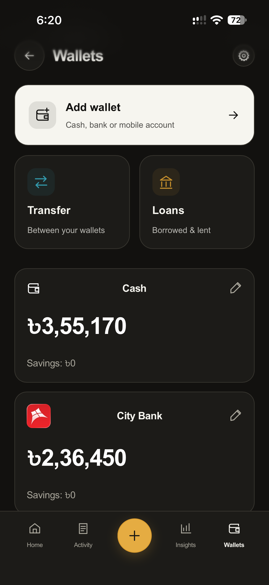</a></td>
    <td align="center"><strong>Budgets</strong><br /><br /><a href="screenshots/budgets.PNG">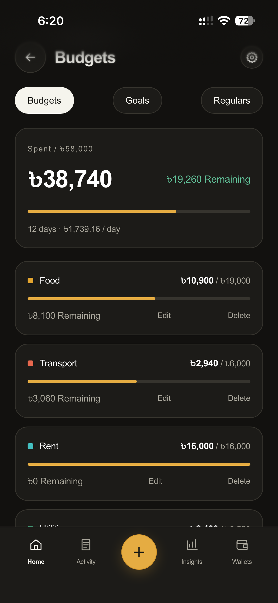</a></td>
    <td align="center"><strong>Goals &amp; savings</strong><br /><br /><a href="screenshots/goals.PNG">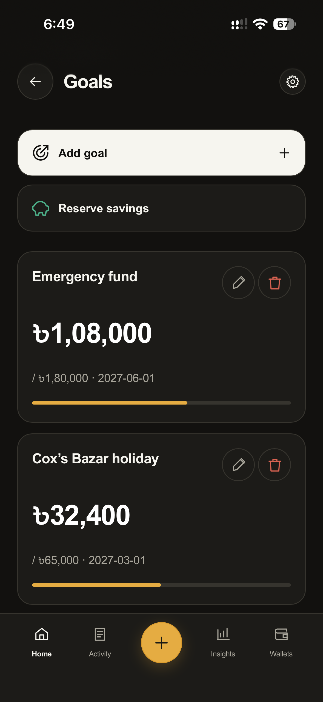</a></td>
  </tr>
</table>

<table>
  <tr>
    <td align="center"><strong>Quick entry</strong><br /><br /><a href="screenshots/add_entry.PNG">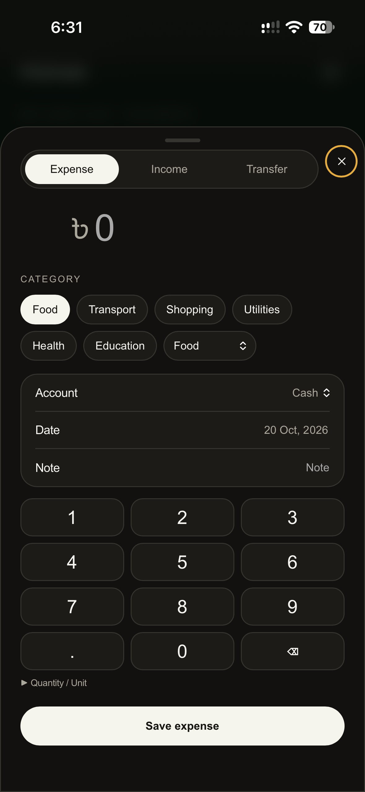</a></td>
    <td align="center"><strong>Wallet transfers</strong><br /><br /><a href="screenshots/wallet_transfer.PNG">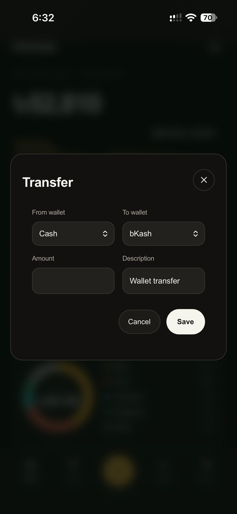</a></td>
    <td align="center"><strong>Loans &amp; repayments</strong><br /><br /><a href="screenshots/loans.PNG">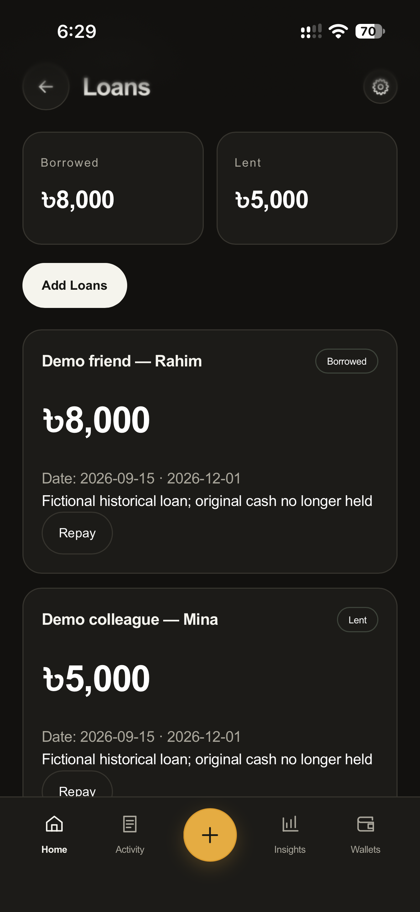</a></td>
  </tr>
</table>

<table>
  <tr>
    <td align="center"><strong>Categories</strong><br /><br /><a href="screenshots/categories.PNG">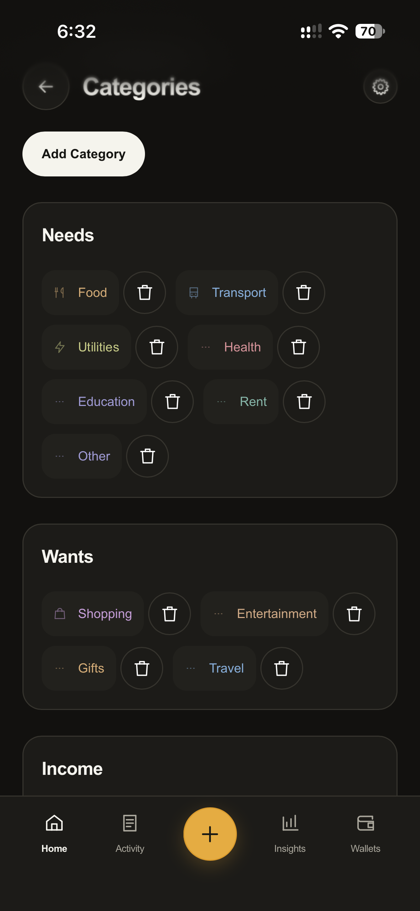</a></td>
    <td align="center"><strong>Settings</strong><br /><br /><a href="screenshots/settings.PNG">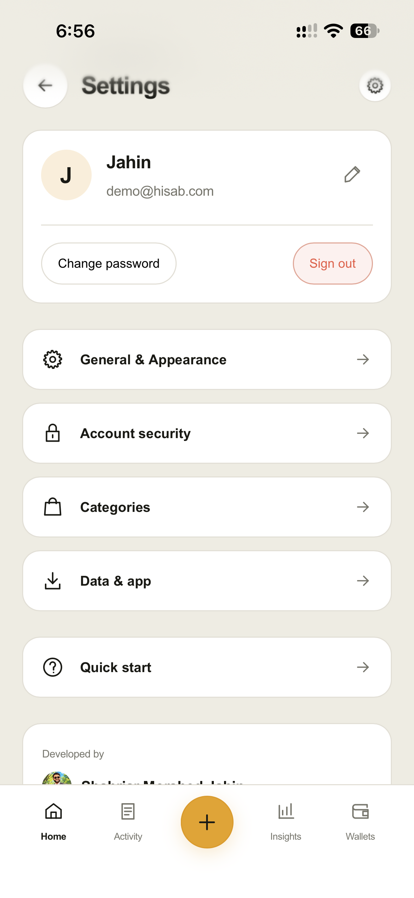</a></td>
    <td align="center"><strong>Import &amp; export</strong><br /><br /><a href="screenshots/data_export_import.PNG">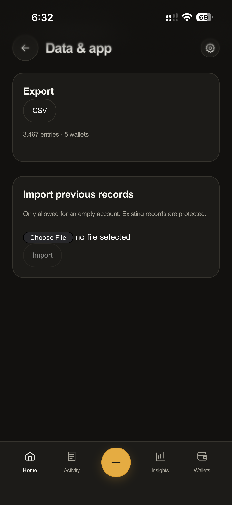</a></td>
  </tr>
</table>

<table>
  <tr>
    <td align="center"><strong>Sign in &amp; passkeys</strong><br /><br /><a href="screenshots/sign_in.PNG">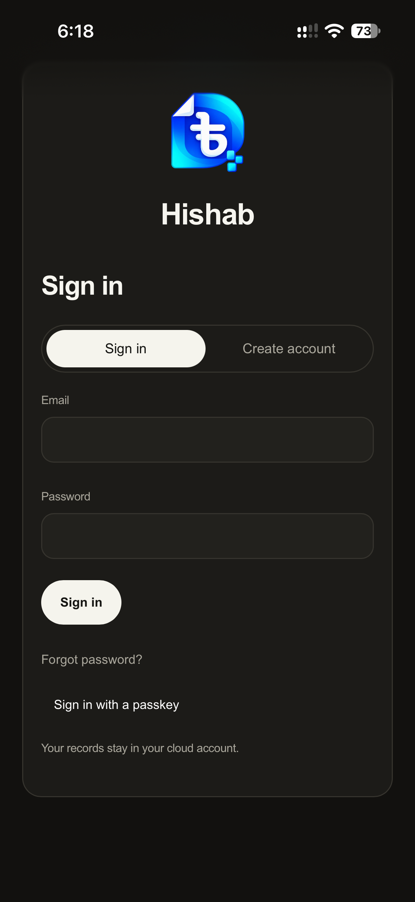</a></td>
    <td align="center"><strong>Create an account</strong><br /><br /><a href="screenshots/sign_up.PNG">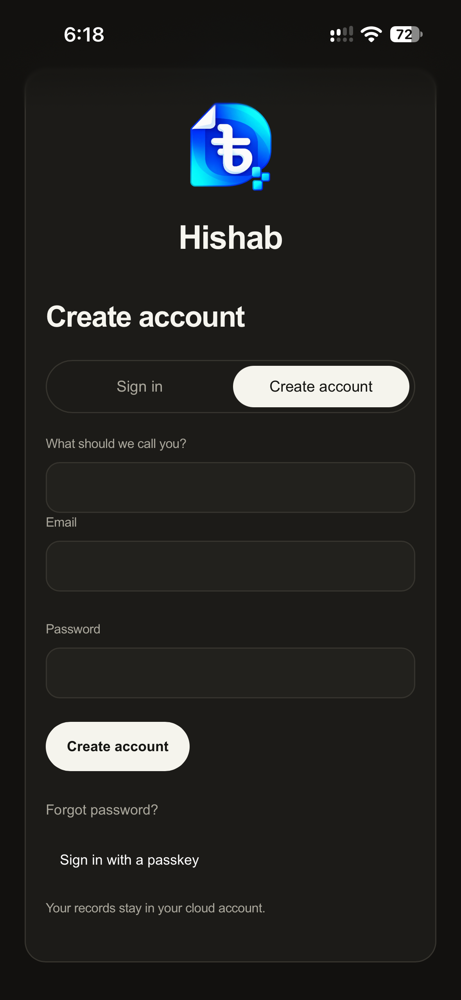</a></td>
  </tr>
</table>

</details>

[Browse all 16 screenshots](screenshots/README.md) · [Interactive gallery](docs/demo/showcase.html)

---

## Features

### Fast Capture & Smart Input
- **Quick templates & wallet memory:** Auto-derived frequent expense/income chips with pinned favorites; remembers your last-used wallet automatically.
- **Bangladesh MFS & bank SMS parser:** Paste or share **bKash, Nagad, Rocket & bank SMS** — automatically detects amounts, descriptions, categories, wallet matches, and splits **Cash Out / transfer fees** cleanly from wallet movements.
- **Voice input & category inference:** Web Speech capture in **English (`en-US`)** and **বাংলা (`bn-BD`)**, Bangla numeral normalization, and live keyword-based category suggestion.
- **Split bills:** Split any expense across multiple friends (`my_share` + per-person loans/receivables recorded atomically).
- **Optimistic saves & offline queue:** Zero-wait optimistic updates on web with automatic background replay on reconnect; durable offline SQLite storage on Android.

### Accounting, Planning & Reporting
- **Multi-wallet ledger:** Manage Cash, MFS, card, and bank accounts with real-time balances, opening balance tracking, custom categories (with icons/colors), and brand logo detection.
- **Transfers, loans & historical debt:** Wallet-to-wallet transfers (with optional fees), borrowed/lent loan ledgers, partial repayments, and pre-existing debt records (`affect_wallet=false`) that keep cash balances accurate.
- **Budgets & savings goals:** Monthly `50/30/20` (Needs / Wants / Savings) targets, per-category spending limits, Asia/Dhaka daily allowance tracking, wallet savings reservations, and target goal tracking.
- **Recurring bills & daily trackers:** Scheduled weekly/monthly/yearly bills with due-date badges and one-tap **Pay**, plus regular daily spending and quantity-unit trackers (`Regulars`).
- **Insights & MoM comparisons:** 12-month cash-flow charts, Month-over-Month category deltas, top expenses, and end-of-month spending pace projections.
- **PDF statements & CSV exports:** Branded multi-page PDF statements (`1`, `3`, `6`, `12` months or custom dates) with wallet filters and running balances — rendered server-side on web and offline on-device on Android — plus filtered CSV and JSON workspace exports.

### Shortcuts, Android Widgets & Automation
- **Shortcut & Quick Webhook (`/quick`):** Generate scoped `hishab_sc_...` tokens under **Settings → Data** with one-tap **Copy quick link**, **Copy popup prompt**, and **Copy API prompt** helpers. Opens a standalone mobile entry sheet (`/quick`) with auto-updated **Top-3 most-used wallets** for iOS Back Tap / Apple Shortcuts (`Show Web View`), Tasker, or MacroDroid — or call `GET /api/shortcuts/wallets` and `POST /api/shortcuts/log` directly.
- **Android Home Screen Widgets:**
  - **Hishab Balance & Quick Add (`4×2` resizable):** Total balance, today's spend, top wallet badge, plus 1-tap **+ Quick Add**, **Paste SMS**, and **Transfer**.
  - **Hishab Quick Bar (`4×1`):** Compact home-screen strip showing today's spend alongside **+ Quick Add** and **SMS** buttons.
- **Android Launcher Shortcuts:** Long-press the app icon for **Quick Add**, **Paste SMS**, or **Transfer** (or pin directly to the home screen / bind Pixel Quick Tap or Samsung Side Key).
- **Android Quick Settings Tile:** Swipe down your status bar shade and tap **Quick Hishab** over any app to open Quick Entry.
- **Android Share Sheet (`Share → Log in Hishab`):** Highlight/share any bank or bKash/Nagad SMS text into Hishab to parse and review immediately.

### AI, Security & Localization
- **Multi-provider Cloud AI:** Natural-language parsing, receipt photo OCR (JPEG/PNG/WebP up to 2 MB), AI budget auto-plan, and context-aware financial advisor chat with automatic failover across **Gemini, OpenAI, Anthropic, Cohere, Mistral, DeepSeek, and OpenRouter**.
- **On-device Android Offline AI:** Optional ~630 MB GGUF `Qwen 3.5 0.8B` (`llama.cpp`) model extracts BDT transactions completely offline on 64-bit devices, always reviewed before saving.
- **Languages, themes & UI:** Full **English** and **বাংলা** localization (`i18n`-verified), Light, Dark, and Liquid Glass themes, BDT and 15+ currencies, reduced-motion support, and interactive onboarding.
- **Security & isolation:** Supabase Auth (email/password, Google/GitHub OAuth, **Passkeys / WebAuthn**, **Authenticator TOTP MFA**), AES-GCM Android Keystore storage, explicit conflict resolution with encrypted recovery copies, and optimistic compare-and-swap cloud revisions.

---

## Android App

Download the signed APK (`com.digitxbd.hishab`, **Android 8.0+ / API 26+**):

**[↓ Latest GitHub Release APK & Checksum](https://github.com/shahriarjahin/my-daily-hishab/releases/latest)**

- **Updates:** Install newer `.apk` releases directly over existing builds (preserving encrypted local records), or check **Settings → Data & app → App updates** in-app for verified GitHub updates.
- **Workspace modes:** Use device-only encrypted offline mode with no account, or sign in to sync with Supabase.
- **Offline AI setup:** Open **Settings → General & Appearance → Offline AI** to download and verify the optional on-device extraction model (requires 64-bit device, 3+ GB RAM, ~900 MB free space).
- **iOS usage:** No native App Store binary is shipped yet; install on Home Screen from Safari and pair Back Tap / Action Button with `/quick`.

---

## Quick Start (Local Development)

Requires **Python 3.12** and **Node.js 22 LTS**.

1. **Configure environment:** Copy `.env.example` to `.env` and populate `SUPABASE_URL`, `SUPABASE_ANON_KEY`, `DATABASE_URL` (Supabase Transaction Pooler URI), and a persistent `HISHAB_SECRET_KEY`.
2. **Apply database migrations** in order inside your Supabase SQL Editor:
   1. [001_hishab.sql](supabase/migrations/001_hishab.sql)
   2. [002_optional_mfa.sql](supabase/migrations/002_optional_mfa.sql)
   3. [003_relational_schema.sql](supabase/migrations/003_relational_schema.sql)
   4. [004_bills_and_shortcuts.sql](supabase/migrations/004_bills_and_shortcuts.sql)
3. **Install, build & run:**

```powershell
python -m venv .venv
.\.venv\Scripts\python.exe -m pip install -r requirements.txt
npm ci --prefix frontend
.\.venv\Scripts\python.exe scripts/build_frontend.py
.\.venv\Scripts\python.exe -m uvicorn backend.main:app --host 127.0.0.1 --port 8001
```

Open **http://127.0.0.1:8001/** (or **http://127.0.0.1:8001/quick** for the standalone Shortcut sheet).

<details>
<summary><strong>Deploy to Vercel</strong></summary>

1. Import the repository as a **FastAPI** project (`app.py` / `vercel.json` include `backend/static/**` and `supabase/migrations/**`).
2. Keep build/output overrides empty; prebuilt assets are committed under `backend/static/react/`.
3. Set `SUPABASE_URL`, `SUPABASE_ANON_KEY`, `DATABASE_URL`, `HISHAB_SECRET_KEY`, and `HISHAB_PUBLIC_URL` in Vercel (plus optional `GOOGLE_API_KEY` / `HISHAB_OWNER_EMAIL`).
4. Add your production URL and `/auth/callback` to Supabase Auth URL Configuration.

Never publish `.env`, signing keys, or financial backups, and keep `HISHAB_SECRET_KEY` constant across deployments. See [CLOUD_DEPLOYMENT.md](docs/CLOUD_DEPLOYMENT.md) and [ACCOUNT_SETUP.md](docs/ACCOUNT_SETUP.md).

</details>

<details>
<summary><strong>Testing & Verification</strong></summary>

```powershell
.\.venv\Scripts\python.exe -m pip install -r requirements-dev.txt
.\.venv\Scripts\python.exe -m unittest discover -s backend -q
.\.venv\Scripts\python.exe -m unittest mobile.test_compatibility -q
npm test --prefix frontend
node --test mobile/test_ledger.cjs
npm run test:browser --prefix frontend
npm run test:passkeys --prefix frontend
```

Browser tests require Google Chrome. All automated suites run against isolated synthetic workspaces and mocked providers.

</details>

---

## Project Architecture

| Path | Responsibility |
| --- | --- |
| `frontend/` | React 19 UI, TypeScript modules, BD SMS parser, smart templates, Vitest & Capacitor config |
| `backend/` | FastAPI routers, relational SQLModel ledger, BD parser, Shortcuts API, PDF statements & compiled SPA |
| `mobile/` | Android Capacitor project, AES-GCM SQLite `Store`, Quick Tile, App Shortcuts, Widgets, Offline AI & APK builder |
| `supabase/migrations/` | Sequential PostgreSQL schemas, RLS policies, relational tables & shortcut token storage |
| `scripts/` | React production build script, icon tools, offline AI prep & relational migration helper |
| `docs/` | Feature specification, deployment, security setup, offline AI, branding/licensing & Play release docs |

---

## Documentation

- [Feature & Accounting Reference](docs/FINANCE_FEATURES.md)
- [Cloud Deployment (Vercel & Supabase)](docs/CLOUD_DEPLOYMENT.md)
- [Account, OAuth, MFA & Passkeys Setup](docs/ACCOUNT_SETUP.md)
- [Frontend Architecture](frontend/README.md)
- [Android Builds, Shortcuts & Signing](mobile/README.md)
- [Optional On-Device Offline AI](docs/OFFLINE_AI.md)
- [Google Play Release Checklist](docs/GOOGLE_PLAY_RELEASE.md)
- [Brand & Wallet Icon Attributions](docs/WALLET_LOGOS.md)

---

<div align="center">

Created by **[Shahriar Morshed Jahin](https://github.com/shahriarjahin)** · **DigitXBD**

[Report an Issue](https://github.com/shahriarjahin/my-daily-hishab/issues) · [Releases](https://github.com/shahriarjahin/my-daily-hishab/releases)

</div>
