# Hishab screenshot gallery

Original iPhone screenshots captured by Shahriar Morshed Jahin using the demo account. Images are preserved as supplied.

[Back to the project](../README.md)

## Home & cash flow

<a href="home.PNG">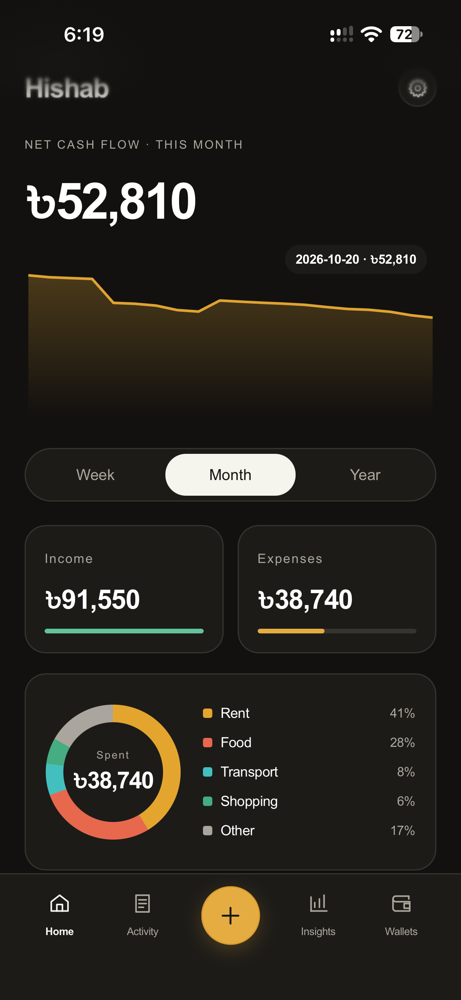</a>

## Activity & filters

<a href="activity.PNG">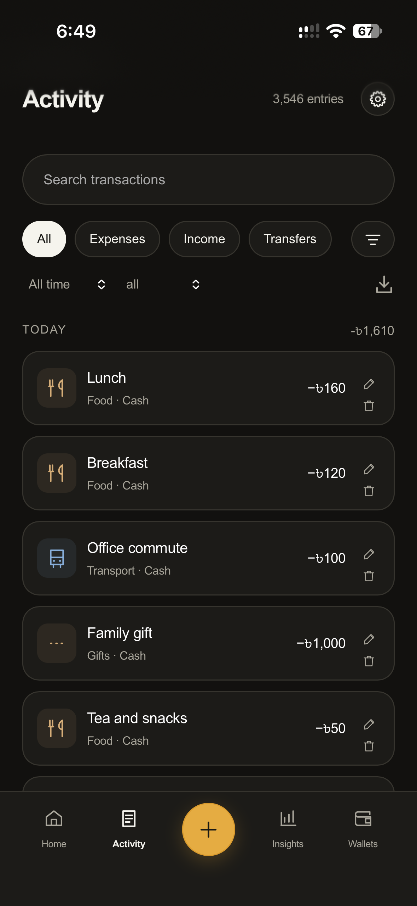</a>

## Spending insights

<a href="insights.PNG">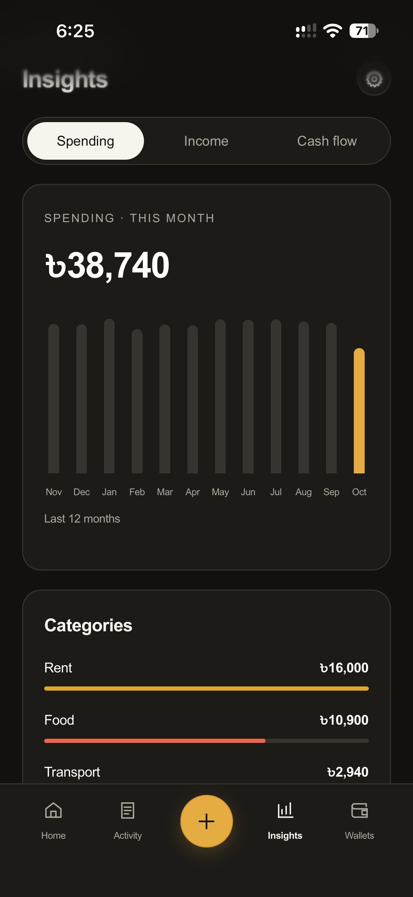</a>

## Light theme

<a href="light_theme.PNG">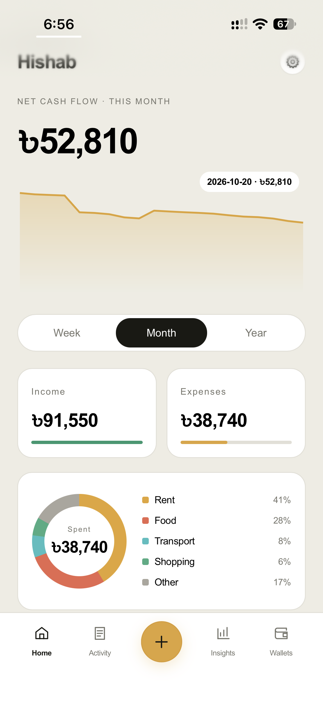</a>

## Glass theme · বাংলা

<a href="glass_theme_BNG.PNG">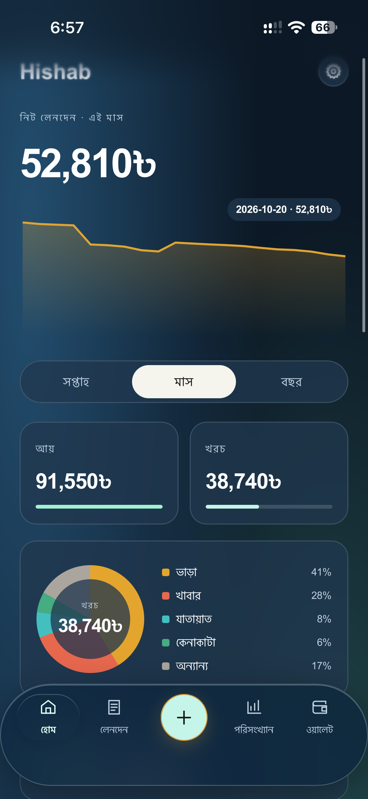</a>

## Wallets

<a href="wallets.PNG">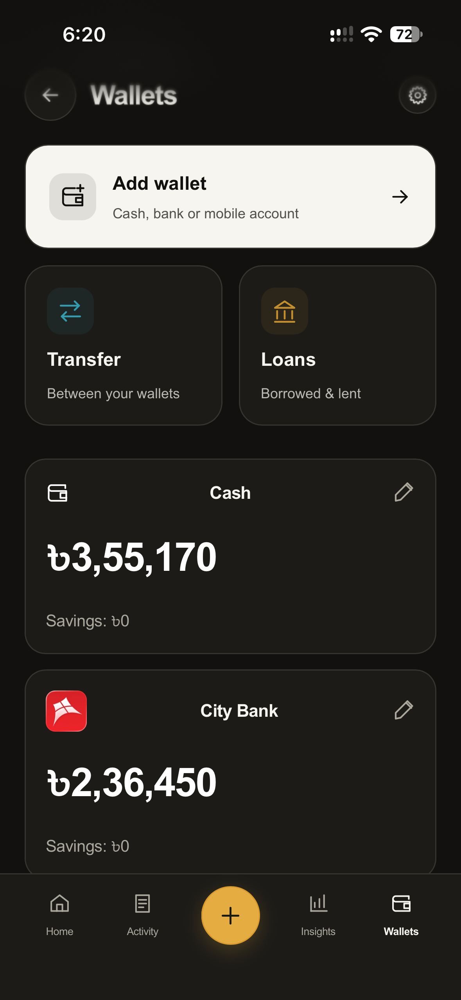</a>

## Budgets

<a href="budgets.PNG">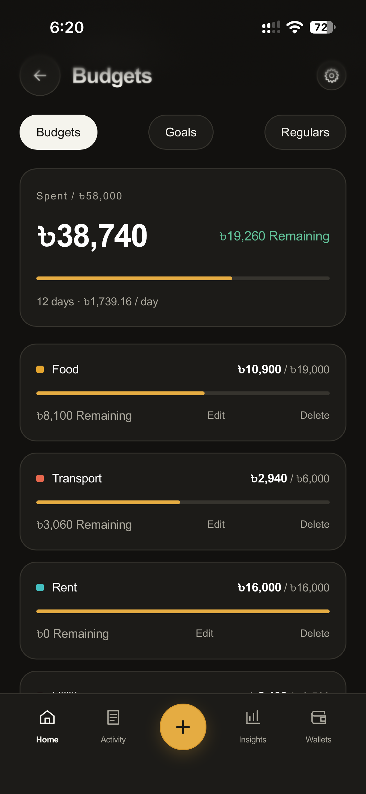</a>

## Goals & savings

<a href="goals.PNG">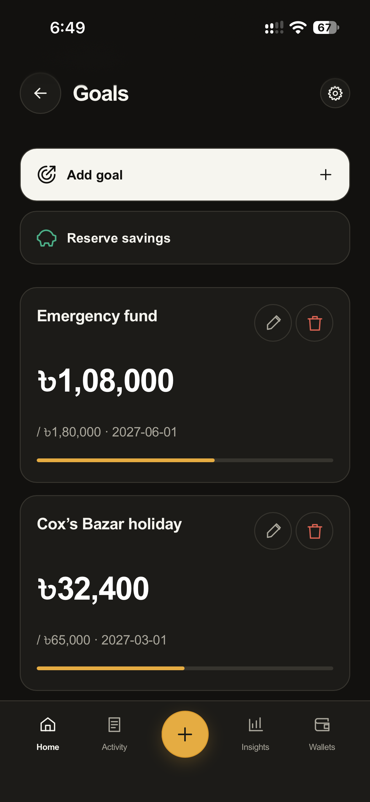</a>

## Quick entry

<a href="add_entry.PNG">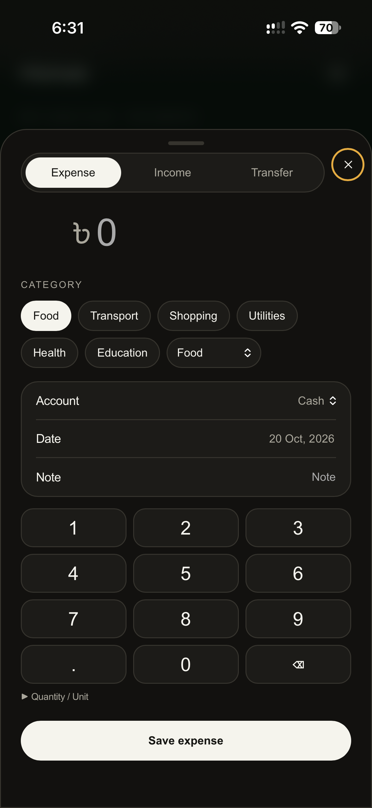</a>

## Wallet transfers

<a href="wallet_transfer.PNG">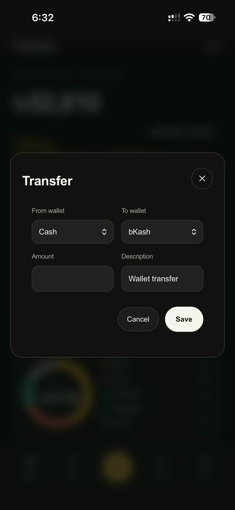</a>

## Loans & repayments

<a href="loans.PNG">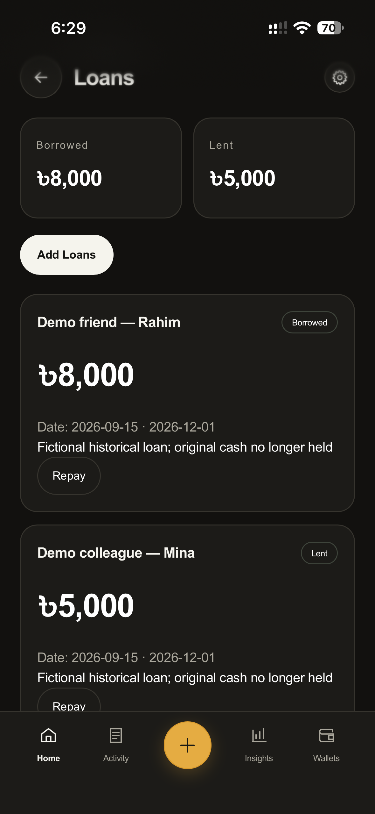</a>

## Categories

<a href="categories.PNG">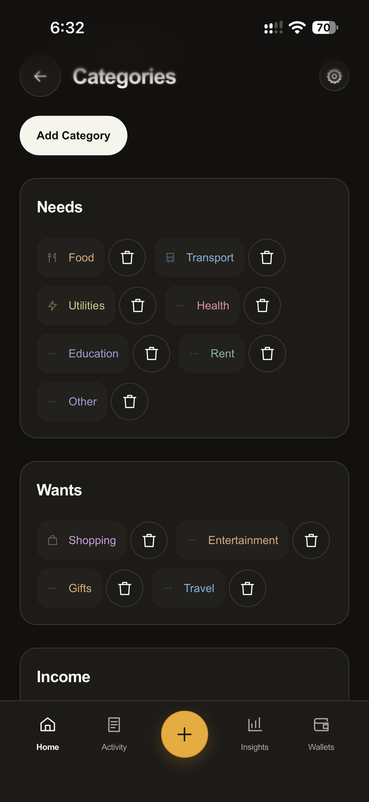</a>

## Settings

<a href="settings.PNG">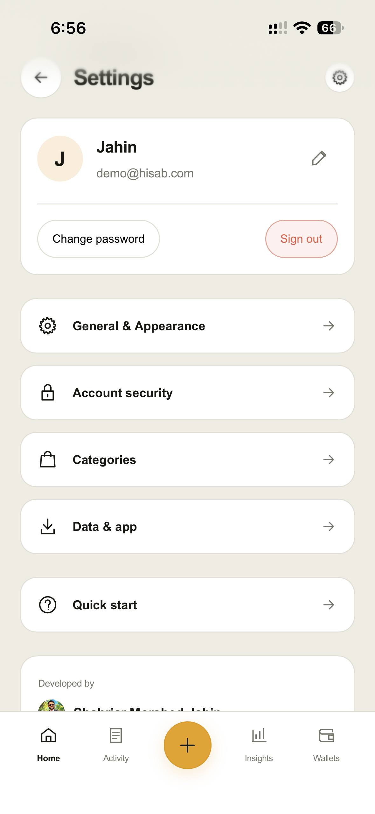</a>

## Import & export

<a href="data_export_import.PNG">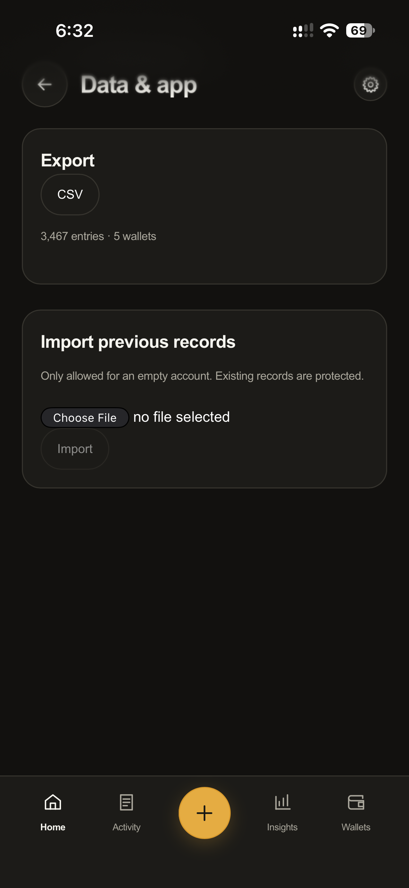</a>

## Sign in & passkeys

<a href="sign_in.PNG">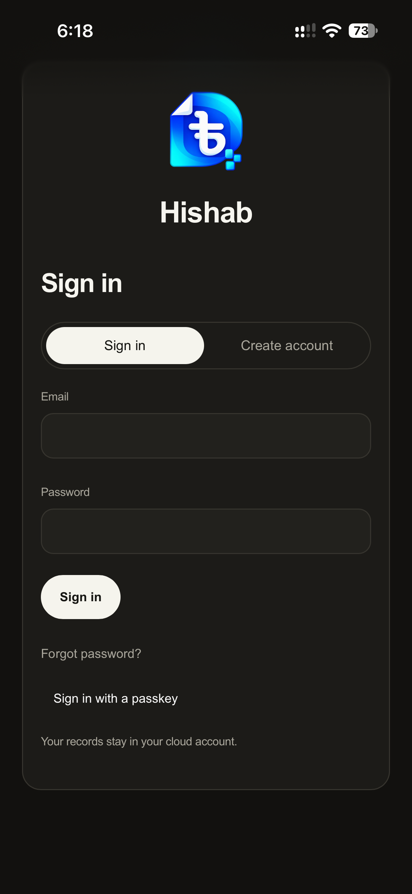</a>

## Create an account

<a href="sign_up.PNG">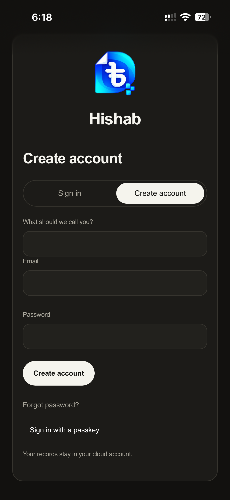</a>
